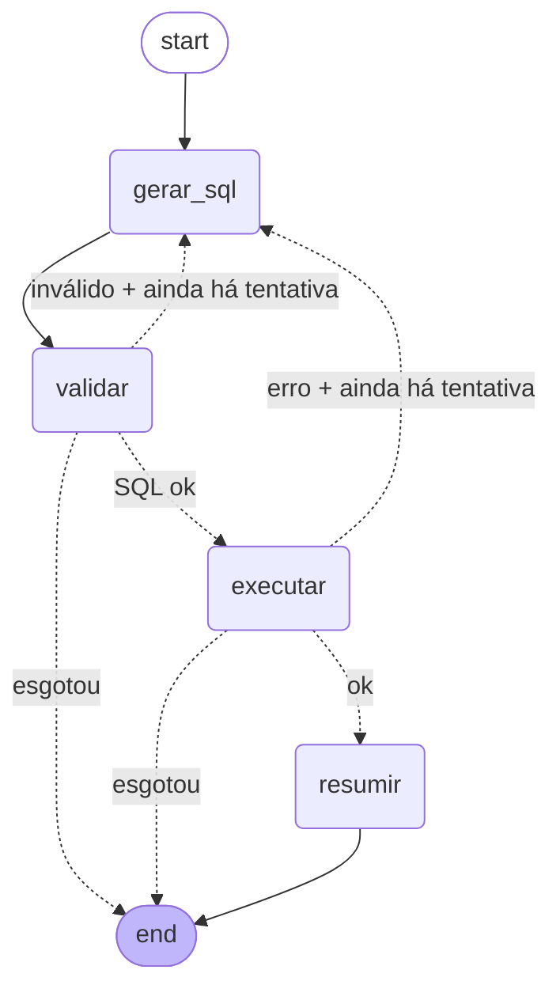

# 🤖 Copiloto de Cobrança — text-to-SQL com LangGraph + Claude

Um **copiloto que responde perguntas de negócio em português** sobre uma base
de cobrança/recuperação de crédito, traduzindo-as para SQL, validando o SQL com
guardrails de segurança, executando numa base **somente-leitura** e devolvendo a
resposta em linguagem natural.

Construído com os **frameworks de GenAI** que o mercado pede em vagas de dados/IA:
**LangGraph** (orquestração de estado em grafo), **LangChain** (`langchain-core`
Runnables + prompts) e **`langchain-anthropic`** (Claude). O domínio escolhido —
cobrança e recuperação — amarra com SQL, que é o ponto forte do autor.

> Dados **100% sintéticos e determinísticos**. Nada aqui vem de base real.

---

## O que este projeto demonstra

| Competência | Onde está no código |
|---|---|
| **LangGraph** — `StateGraph`, nós, arestas condicionais, retry/auto-correção | `copiloto/graph.py` |
| **LangChain** — `Runnable`, `ChatPromptTemplate`, `with_structured_output`, `StrOutputParser` | `copiloto/llm.py` |
| **Claude** via `langchain-anthropic` (`ChatAnthropic`, modelo configurável) | `copiloto/llm.py` |
| **Text-to-SQL** com saída **estruturada** (Pydantic `SQLDraft`) | `copiloto/llm.py` |
| **Prompt engineering** — system/human prompts, injeção de schema e de erro p/ auto-correção | `copiloto/llm.py` |
| **Guardrails / segurança** — allowlist de tabelas, bloqueio de DDL/DML, injeção de `LIMIT`, conexão `mode=ro` + authorizer SQLite | `copiloto/guardrails.py`, `copiloto/db.py` |
| **Engenharia de software** — pacote modular, testes, modo offline p/ CI | `tests/`, `pytest.ini` |

---

## Arquitetura (o grafo LangGraph)



1. **gerar_sql** — Claude traduz a pergunta em um `SQLDraft(sql, explicacao)`
   (saída estruturada via tool calling). Se houve erro na tentativa anterior,
   ele entra no prompt para o modelo **se auto-corrigir**.
2. **validar** — guardrails de texto: só `SELECT`/`WITH`, uma instrução,
   nenhuma palavra perigosa, só tabelas do schema, `LIMIT` garantido.
3. **executar** — roda numa conexão **somente-leitura** (`mode=ro` + authorizer
   do SQLite). Mesmo que um SQL hostil passasse pelo texto, o banco recusa escrita.
4. **resumir** — Claude resume o resultado em 1–3 frases para um gestor.

As arestas condicionais (`validar`/`executar` → `gerar_sql`) são o laço de
**auto-correção**: até `MAX_TENTATIVAS` (3) o copiloto reescreve o SQL usando a
mensagem de erro como contexto.

---

## Segurança (por que confiar no SQL que o LLM gerou)

Defesa **em profundidade** — duas camadas independentes:

- **Textual** (`guardrails.py`): rejeita múltiplas instruções (`;`), qualquer
  `INSERT/UPDATE/DELETE/DROP/ALTER/ATTACH/PRAGMA/…`, tabelas fora da allowlist, e
  injeta `LIMIT` se faltar. Comentários e literais são higienizados antes da
  análise para evitar falso-positivo/negativo.
- **De banco** (`db.py`): a conexão é aberta em `file:...?mode=ro` **e** com um
  `set_authorizer` que só permite `SELECT`/`READ`/`FUNCTION`. Escrita é negada
  pelo próprio SQLite.

---

## Como rodar

```bash
pip install -r requirements.txt

# modo OFFLINE (sem chave): regras determinísticas — ideal para demo/CI
COPILOTO_OFFLINE=1 python -m copiloto.cli --demo

# uma pergunta específica
python -m copiloto.cli "Qual escritório tem mais acordos quebrados?"

# modo ONLINE (Claude de verdade): defina a chave e pergunte qualquer coisa
export ANTHROPIC_API_KEY=sk-ant-...
python -m copiloto.cli "Qual a taxa de recuperação por segmento de cliente em 2026?"
```

Modelo configurável por env (`COPILOTO_MODEL`, default `claude-opus-5`; use
`claude-sonnet-5` para baratear). Veja `.env.example`.

### Modo offline vs. online

| | Offline (default sem chave) | Online (`ANTHROPIC_API_KEY`) |
|---|---|---|
| Geração de SQL | regras determinísticas (perguntas da demo) | **Claude** — qualquer pergunta |
| Resumo | template | **Claude** — linguagem natural |
| Rede / custo | zero | chamadas à API da Anthropic |
| Uso | demo, testes, CI | uso real |

O grafo é **idêntico** nos dois modos — só muda o `Runnable` por trás (é esse o
truque de design que mantém o LangGraph agnóstico ao backend).

---

## Exemplo de saída (modo offline)

```
❓ Quanto foi recuperado por escritório?

🧮 SQL gerado:
SELECT e.nome AS escritorio, ROUND(SUM(p.valor_pago), 2) AS total_recuperado
FROM pagamentos p
JOIN acordos a   ON a.acordo_id = p.acordo_id
JOIN contratos c ON c.contrato_id = a.contrato_id
JOIN escritorios e ON e.escritorio_id = c.escritorio_id
GROUP BY e.nome
ORDER BY total_recuperado DESC
LIMIT 200

📊 Resultado:
escritorio   | total_recuperado
-------------------------------
SISCOM       | 490274.24
REDE BRASIL  | 356738.31
AVAL         | 351258.79
TSP          | 345011.08
PASCHOALOTTO | 254420.73
BELLINATI    | 235018.86
GRB          | 226206.05
```

---

## O banco (dados sintéticos)

5 tabelas — `escritorios`, `clientes`, `contratos`, `acordos`, `pagamentos` —
geradas de forma determinística (`seed=42`): 7 escritórios, 400 clientes,
650 contratos e os acordos/pagamentos correlacionados. Schema completo em
`copiloto/schema.py`.

---

## Testes

```bash
python -m pytest        # 23 testes, 100% offline (não tocam a rede)
```

Cobrem: guardrails (comandos perigosos recusados, `LIMIT` injetado, CTE
permitida, falso-positivo em string), banco (povoamento, determinismo,
somente-leitura, truncamento) e o grafo end-to-end — **incluindo a
auto-correção** quando o 1º SQL é inválido.

---

## Estrutura

```
copiloto-cobranca-sql/
├── copiloto/
│   ├── schema.py       # DDL + descrição do schema p/ o prompt + allowlist
│   ├── seed.py         # gerador de dados sintéticos determinístico
│   ├── db.py           # conexão somente-leitura + execução segura
│   ├── guardrails.py   # validação textual do SQL (defesa em profundidade)
│   ├── llm.py          # ChatAnthropic (online) / stub de regras (offline)
│   ├── graph.py        # o grafo LangGraph (gerar→validar→executar→resumir)
│   └── cli.py          # interface de linha de comando
├── tests/              # pytest (offline, determinístico)
├── data/               # banco SQLite (gerado na 1ª execução)
├── requirements.txt
└── README.md
```

---

*Projeto de portfólio — Leandro Mariotti. Frameworks: LangGraph · LangChain ·
Anthropic Claude · SQLite · Pydantic.*
